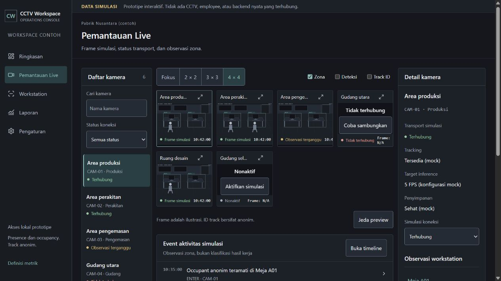

# Opsi 16 kamera pada prototipe

## Koreksi setelah pemeriksaan pengguna

Pilihan layout harus menampilkan seluruh slot, termasuk slot yang belum memiliki kamera. `Live.jsx` sekarang mengisi kapasitas grid dengan tombol slot kosong yang membuka form Tambah kamera simulasi. Slot tidak dibuat saat filter tidak menemukan hasil, sehingga pesan Tidak ada kamera yang cocok tetap berlaku. Fokus tetap menampilkan satu kamera.

Build ulang berhasil. Pemeriksaan browser menghitung 3 x 3 = 9 elemen (6 kamera + 3 slot kosong) dan 4 x 4 = 16 elemen (6 kamera + 10 slot kosong), dengan tiga dan empat kolom sesuai pilihan. Tidak ada overflow dokumen pada viewport pengujian. Klik slot 7 membuka dialog Tambah kamera simulasi. [Bukti terbaru](evidence-001-fixes-567-2026-10-22/08-full-grid16.jpg).

Delivery Gate koreksi: Hard Gate PASS berdasarkan build, jumlah slot dan dialog yang terbuka; Purpose-Gate PASS karena slot kosong memperlihatkan kapasitas tanpa mengarang kamera; Liveliness PASS dengan dials 1/1/1 dan gaya yang sama; Craftsmanship PASS karena kapasitas dan isi dibedakan secara eksplisit. Catatan enam tile di bawah merupakan hasil sebelum koreksi ini.

Pilihan grid prototipe pada `prototype/src/Live.jsx` masih berhenti di 3 x 3, sementara dashboard engine sudah mendukung 16 kamera. Menambahkan pilihan 4 x 4 dan aturan empat kolom di `prototype/src/styles.css` menyamakan kemampuan pemilihan layout kedua halaman.

Build berhasil. Pada browser, klik 4 x 4 menghasilkan `camera-grid layout-16`, empat kolom terukur masing-masing 142,167 px pada viewport pengujian, dan tidak ada overflow dokumen. Dataset contoh berisi enam kamera, sehingga enam tile ditampilkan; tidak dibuat kamera palsu atau slot tambahan untuk mengisi grid. Ini memverifikasi pilihan dan layout, bukan performa 16 stream nyata.

Delivery Gate antislop, lingkup perubahan ini:

- PASS, Hard Gate: build berhasil; kontrol 4 x 4 diklik dan empat kolom terukur tanpa overflow dokumen pada viewport pengujian.
- PASS, Purpose-Gate: opsi baru memulihkan kapasitas layout yang diminta; typography, warna dan komponen mengikuti pilihan grid yang ada.
- PASS, Liveliness: ENERGY 1 / RHYTHM 1 / MOTION 1 tetap; grid kamera menjadi fokus dan pilihan aktif memakai aksen yang ada.
- PASS, Craftsmanship: sumber kamera yang sama tetap digunakan, hanya batas tampilan dinaikkan menjadi 16; data contoh tetap diberi label simulasi.
