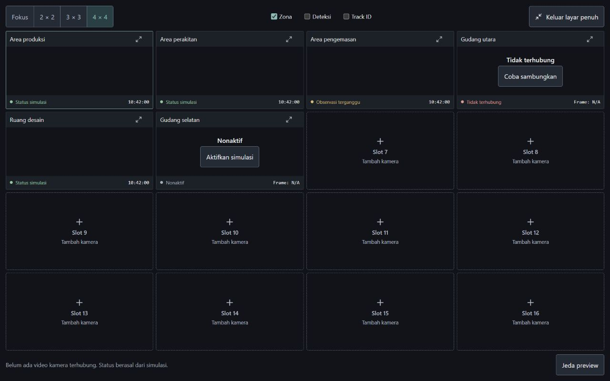

# Layar penuh seluruh grid kamera

Tombol **Layar penuh semua kamera** pada prototipe Pemantauan Live membuka toolbar dan grid bersama. Sidebar, daftar kamera, event dan detail berada di luar area fullscreen. Grid menyesuaikan baris terhadap tinggi layar agar 4 x 4 menampilkan 16 slot sekaligus. Pilihan layout, status simulasi dan slot kosong tetap tersedia.

Browser yang mendukungnya diminta memakai Fullscreen API. Jika permintaan tidak tersedia atau ditolak, area monitoring memakai overlay penuh jendela. Tombol Keluar layar penuh dan Escape menutupnya. Pemilihan layout tetap tersimpan dalam komponen setelah keluar. Memilih fullscreen semua kamera dari mode Fokus mengembalikan grid. Tombol layar penuh kamera tunggal tetap tersedia saat fokus.

File: `prototype/src/Live.jsx` dan `prototype/src/styles.css`. Dials tetap ENERGY 1 / RHYTHM 1 / MOTION 1. Alasan tata letak: ruang layar diprioritaskan untuk video, dengan kontrol layout dan keluar selalu berada di area yang sama. Slot kosong tetap ditandai sebagai tempat menambah kamera, tidak dianggap stream aktif.

## Verifikasi

- Build terakhir berhasil.
- Browser pemeriksaan memakai fallback overlay karena fullscreen native tidak aktif. Fullscreen native belum diverifikasi pada browser eksternal.
- Viewport 1280 x 800: area monitoring 1280 x 800, grid empat kolom sekitar 309,5 px dan empat baris sekitar 163,17 px. Ada 16 slot tanpa overflow grid atau panel.
- Beralih ke 3 x 3 ketika fullscreen menghasilkan 9 slot; kembali ke 4 x 4 menghasilkan 16 slot.
- Tombol keluar dan Escape mengembalikan halaman; pilihan 4 x 4 bertahan dan scroll body dipulihkan.
- Shift+Tab dari kontrol pertama memindahkan fokus ke kontrol terakhir di dalam area fullscreen.
- Klik slot 7 menutup fullscreen lalu membuka form Tambah kamera; tombol Tutup dialog bekerja.
- Log warning/error browser kosong selama pemeriksaan terakhir. Ini merupakan verifikasi UI dengan data simulasi, bukan uji stream kamera nyata.

## Delivery Gate, lingkup perubahan

- PASS, Hard Gate: build berhasil; 16 slot muat dalam viewport pengujian; layout, keluar, Escape, keyboard dan form tambah kamera diperiksa langsung.
- PASS, Purpose-Gate: ukuran baris mengikuti ruang layar untuk monitoring serentak; kontrol dan warna mengikuti komponen yang ada, tanpa asset atau animasi baru.
- PASS, Liveliness: dials 1/1/1 dipertahankan; grid menjadi fokus, aksen menunjukkan layout terpilih dan batas slot membentuk ritme.
- PASS, Craftsmanship: fallback browser tersedia, fokus keyboard tetap di area fullscreen, konteks grid bertahan dan form tambah kamera dibuka setelah keluar agar tidak tersembunyi di belakang elemen fullscreen.
