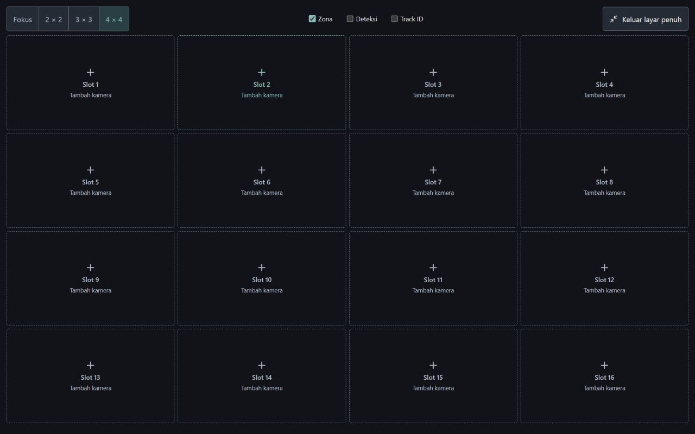

# Workspace tanpa data demo

Permintaan pengguna: hapus tulisan dan data placeholder pada tampilan dev. Kamera, workstation, event, histori tahunan dan lokasi fiktif tidak lagi dibuat oleh initial state. Generator histori dan pergantian observasi otomatis dihapus; waktu awal memakai waktu saat aplikasi dibuka. Penyimpanan browser menggunakan versi 2 dan menghapus dataset demo versi 1 ketika dimuat.

Banner DATA SIMULASI, nama lokasi contoh, panel skenario, kontrol simulasi dan pengaturan dummy tidak lagi ditampilkan. Ringkasan dan laporan menampilkan kondisi kosong. Form kamera memiliki nama, area dan RTSP kosong; FPS 5 tetap merupakan nilai konfigurasi awal, bukan pengukuran. Status engine yang belum terhubung tetap dinyatakan secara eksplisit. Konfigurasi browser tidak mengklaim sudah membuka stream.

Grid dan fullscreen dipertahankan, termasuk 16 slot kosong pada 4 x 4. Ilustrasi pabrik di editor zona diganti kanvas polos dengan geometri yang ditentukan pengguna. Polygon awal kosong. Tidak ada kamera palsu ditambahkan untuk mengisi slot.

Ini merupakan perubahan tampilan standalone pada server Vite. SQLite dan observasi dari engine Python tidak dihapus.

Verifikasi:

- Build berhasil; 16 tes frontend lulus.
- Pemeriksaan initial state dan advance: kamera, workstation, event, interval dan histori tetap kosong; tidak ada observasi yang dibangkitkan.
- Kelima halaman utama diperiksa melalui browser: tidak ada teks simulasi/contoh/mock/lokasi fiktif yang dicari dalam tampilan default, tidak ada ilustrasi atau overflow dokumen pada viewport pemeriksaan.
- Grid fullscreen 4 x 4: 16 slot, 0 kamera, 0 gambar contoh.
- Form Tambah kamera: nama, area, RTSP kosong dan tanpa placeholder. Tombol Batal bekerja.
- Setelah reload tetap 0 kamera dan teks demo tidak kembali. Log warning/error terakhir kosong.

Delivery Gate antislop untuk keadaan yang diperiksa:

- PASS, Hard Gate: build dan tes berhasil; navigasi lima halaman, fullscreen, form dan reload diperiksa; tidak ada data palsu pada tampilan default.
- PASS, Purpose-Gate: keadaan kosong membedakan konfigurasi yang belum dibuat dari hasil observasi; label tindakan tetap tersedia untuk memulai konfigurasi.
- PASS, Liveliness: ENERGY 1 / RHYTHM 1 / MOTION 1 tetap; grid kamera menjadi fokus dengan aksen pilihan yang sama.
- PASS, Craftsmanship: pembersihan mencakup initial state, histori otomatis dan cache browser lama, sehingga refresh tidak mengembalikan demo. Form tidak mengklaim koneksi nyata sebelum engine terhubung.

Pemeriksaan ini tidak mencakup seluruh suite Playwright lama, stream nyata atau audit menyeluruh atas mode engine. Bukti dan sumber berubah lokal; belum dipush pada langkah ini.
