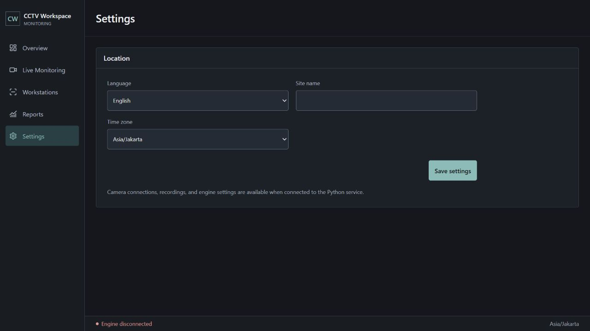

# Pilihan bahasa

Pengaturan pada tampilan standalone memiliki pilihan Bahasa Indonesia dan English. Perubahan diterapkan langsung melalui React context, tersimpan pada `cctv-language` di browser, dan memperbarui atribut bahasa dokumen. Tidak ada manipulasi terjemahan melalui DOM atau layanan eksternal.

Cakupan terjemahan tahap ini: navigasi utama, judul halaman, pengaturan lokasi, status umum, tombol bersama, label form, pilihan filter laporan, tab laporan kosong, empty state dan slot tambah kamera. Nama lokasi/kamera yang dimasukkan pengguna tidak diterjemahkan sebagai data. Pesan teknis dari backend dan beberapa rincian lama belum memiliki terjemahan menyeluruh.

Verifikasi: build berhasil; browser menunjukkan navigasi serta Settings/Location/Language/Site name/Time zone/Save settings dalam English. Setelah reload, English tetap terpilih dan `html lang=en`. Reports menampilkan No observation data. Memilih Bahasa Indonesia mengembalikan judul Pengaturan dan `html lang=id`. Log warning/error kosong.

Delivery Gate lingkup ini:

- PASS, Hard Gate: pilihan bahasa, persistensi reload dan pergantian kembali diuji; build berhasil; label form tetap terhubung ke kontrol.
- PASS, Purpose-Gate: satu preferensi bahasa dipakai bersama, sehingga pengaturan dan navigasi berubah serentak tanpa mengganti data pengguna.
- PASS, Liveliness: ENERGY 1 / RHYTHM 1 / MOTION 1 tetap; tidak ada gaya atau animasi baru.
- PASS, Craftsmanship: terjemahan memakai state React, atribut bahasa dokumen diperbarui, penyimpanan yang tidak tersedia ditangani dan sumber Indonesia menjadi fallback.
