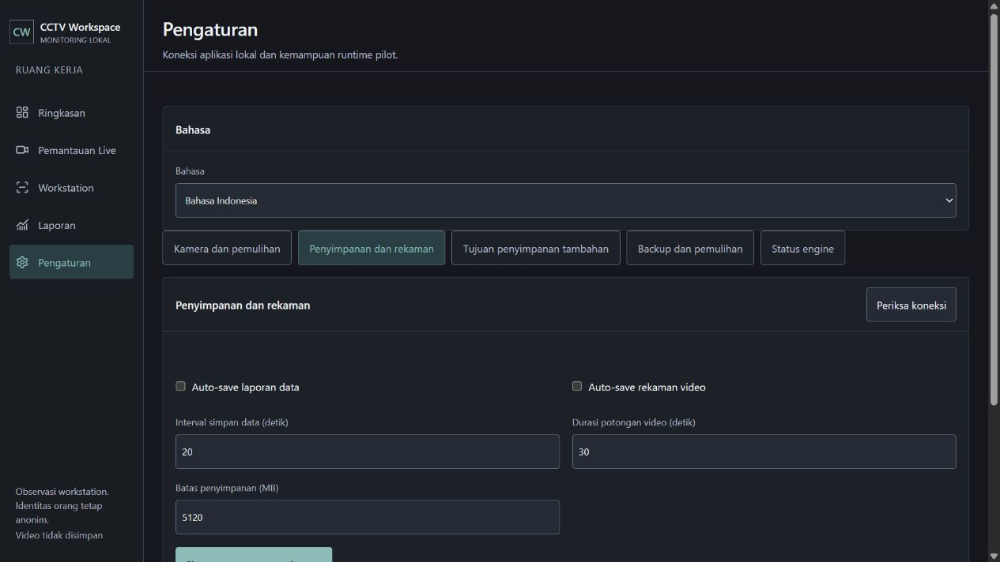

# Opsi pengaturan operasional

Menambahkan seluruh kelompok pengaturan yang disetujui pengguna. Lokasi, zona waktu dan bahasa tetap tersedia pada tampilan dev. Lima kelompok operasional baru memakai endpoint backend yang sudah ada pada master:

| Kelompok | Kontrol | Kontrak backend |
| --- | --- | --- |
| Kamera dan pemulihan | Daftar kamera, status, pemulihan otomatis per kamera | `camera-wall`, `camera-wall/cameras/:id/recovery` |
| Penyimpanan dan rekaman | Auto-save data/video terpisah, interval 5-3600 detik, batas storage, folder lokal | `recordings`, `recordings/policy` |
| Tujuan penyimpanan tambahan | Lokal, folder/server/NAS, remote rclone, S3 beserta kredensial, prefix, uji tujuan, antrean dan retry upload gagal | `recordings/destination`, `/test`, `/retry` |
| Backup dan pemulihan | Backup manual, jadwal 24 jam, retensi 1-365 hari, daftar backup, verifikasi, panduan restore | `maintenance`, `/backup`, `/policy`, `/backups/:id/verify` |
| Status engine | Koneksi, model, perangkat inferensi, zona waktu, versi skema, error terakhir, refresh | `status?dataset=live` |

Penyimpanan lokasi dan bahasa adalah preferensi lokal. Opsi operasional tidak menyimpan keadaan palsu ketika backend belum terhubung: formulir mutasi dinonaktifkan dan petunjuk koneksi ditampilkan. Jenis tujuan masih dapat dipilih untuk melihat field yang diperlukan. Data konfigurasi awal dibaca dari server; tidak ada data contoh atau metrik fiktif. Bahasa Indonesia dan English didukung pada label baru.

Restore ditampilkan sebagai instruksi offline berdasarkan perintah dari backend. Penggantian database tidak dijalankan dari browser saat aplikasi masih menulis. Data zona tetap di Pemantauan Live dan filter periode tetap di Laporan.

Implementasi: `prototype/src/settings-tools.jsx`, `settings-tools.css`, `Management.jsx`, `EngineApp.jsx`, `language.jsx`. Style memakai warna, komponen, grid dan target sentuh yang sudah ada. Dials ENERGY 1 / RHYTHM 1 / MOTION 1.

## Bukti

- Build terakhir berhasil; 16 tes frontend lulus.
- Mode Vite pada 5173: lima bagian dapat dibuka. Tidak ada tombol simpan operasional aktif saat engine belum terhubung. Pemilihan S3 memperlihatkan endpoint, bucket, region/provider dan tiga field kredensial yang tetap dinonaktifkan.
- Validasi terintegrasi memakai backend master pada checkout `runtime/merge-ui-master`, UI hasil build terbaru, port 8776, serta database terpisah `runtime/settings-check.sqlite3`. Source backend di checkout utama bukan bagian dari perubahan ini; kompatibilitas diuji terhadap backend master yang sudah mendukung endpoint tersebut.
- Kebijakan rekaman: interval data diubah menjadi 20 detik dan potongan video menjadi 30 detik, lalu dibaca ulang setelah berpindah panel. Nilai bertahan. Data/video tetap nonaktif pada database uji.
- Tujuan folder lokal: konfigurasi tersimpan; uji backend menyatakan file uji ditulis, diverifikasi dan dihapus. Tidak ada koneksi NAS/cloud/S3 nyata diuji.
- Backup: retensi diubah menjadi 14 hari, backup manual dibuat dan backup diverifikasi tanpa error. Panduan restore membuka perintah untuk ID backup yang benar. Restore sendiri tidak dijalankan.
- Kamera loopback yang sengaja tidak tersedia didaftarkan pada database uji. Recovery otomatis diaktifkan melalui UI dan tetap aktif setelah panel dibuka kembali. Tidak ada klaim analisis kamera nyata.
- Status engine menampilkan model YOLOX-S OpenVINO CPU, perangkat host, zona waktu dan skema 4 dari respons backend.
- Lima panel diuji pada lebar 390 px: tidak ada overflow dokumen, dan kontrol aktif yang diukur memiliki tinggi minimal 44 px. Override viewport direset setelah pemeriksaan.
- English menampilkan kelima label bagian dengan benar; kembali ke Bahasa Indonesia bekerja. Log mode dev terakhir kosong.
- Server pengujian 8776 ditutup; dev server pengguna 5173 tetap berjalan.

## Delivery Gate, lingkup yang diperiksa

- PASS, Hard Gate: build dan tes lulus; aksi simpan, baca ulang, uji folder, backup, verifikasi dan recovery diuji dengan database terpisah. Offline tidak memberikan keberhasilan palsu; pengukuran ponsel tidak menemukan overflow atau target aktif kecil.
- PASS, Purpose-Gate: pemisahan mengikuti fungsi backend nyata; field rahasia tidak disimpan pada localStorage, dan instruksi restore mengikuti persyaratan backend offline.
- PASS, Liveliness: dials 1/1/1 dipertahankan; bagian aktif memakai aksen yang ada, form mengikuti ritme grid dan kontrol tugas menjadi fokus.
- PASS, Craftsmanship: mutasi memiliki guard saat sibuk, error ditampilkan, data dibaca ulang dari server, kredensial input dibersihkan setelah penyimpanan dan preferensi bahasa dipertahankan.

Ini bukan validasi produksi, uji cloud/S3/NAS, pemulihan database aktual, atau uji seluruh suite Playwright lama. Perubahan belum dipush pada langkah ini.
