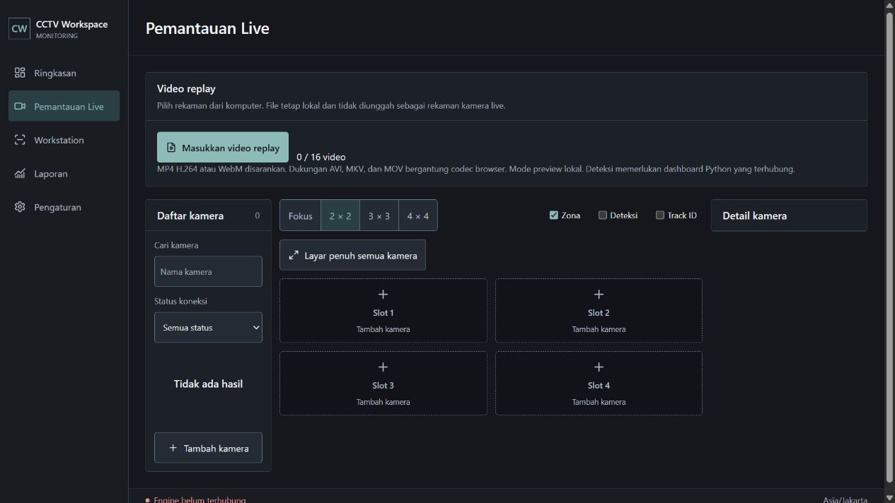

# Panel video replay dipulihkan

Panel import/pemutaran video lokal ditemukan di checkout `21f5`, tetapi modulnya belum ada pada checkout OneDrive yang melayani Vite. Menyalin implementasi `video-replay.jsx` dan CSS yang sudah ada, lalu memasang panel pada Shell dan EngineApp. Komponen tetap mounted saat berpindah halaman agar pilihan video tidak hilang; tidak ada video atau data contoh yang dimasukkan otomatis.

Modul mendukung hingga 16 file lokal, layout 1/4/9/16, play/pause, seek, kecepatan, loop, fullscreen dan penghapusan video. Pada checkout ini endpoint analisis `replay/frame` belum tersedia, sehingga analisis replay tidak diaktifkan. Pemutaran lokal tidak menulis observasi atau durasi ke laporan.

Verifikasi: build berhasil setelah kedua jalur aplikasi dipasang. Browser pada `http://127.0.0.1:5173/#/live` menunjukkan panel Video replay, tombol Masukkan video replay dan 0/16 video. Log warning/error kosong. Pada langkah ini tidak ada file video diimpor melalui browser, sehingga hasil ini memverifikasi pemulihan panel, bukan seluruh kontrol playback atau codec.

Delivery Gate lingkup pemulihan panel:

- PASS, Hard Gate: build dan render browser berhasil; input file lokal terhubung ke kontrol import dari modul yang dipulihkan.
- PASS, Purpose-Gate: memakai kembali implementasi milik proyek agar fungsi replay terpisah dari kamera live dan pencatatan durasi.
- PASS, Liveliness: ENERGY 1 / RHYTHM 1 / MOTION 1 mengikuti konsol yang ada.
- PASS, Craftsmanship: tidak mengembalikan fixture; komponen tetap mounted dan cleanup object URL dari implementasi asli dipertahankan. Deteksi tidak diaktifkan tanpa endpoint backend.

