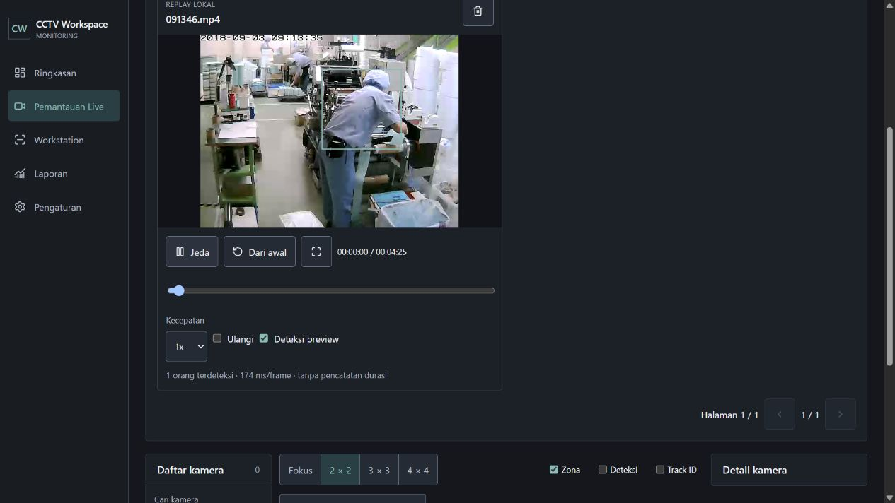

# Engine untuk video replay

Menambahkan endpoint autentikasi `GET /pilot/v1/replay/status` dan `POST /pilot/v1/replay/frame` pada backend checkout utama. Frame JPEG replay diproses oleh detektor yang sama dengan preview webcam. Route replay dipisahkan sebelum penanganan sesi live, sehingga header sesi tidak dapat mengalihkannya ke accounting. Respons selalu menandai `LOCAL_VIDEO_REPLAY`, `recorded=false`, `tracking_supported=false` dan `duration_accounting=false`.

Vite meneruskan `/pilot/` dan bootstrap sesi melalui proxy loopback ke backend 8765. Host dan Origin tetap dipertahankan; autentikasi, cookie HttpOnly dan pemeriksaan Origin backend tidak dinonaktifkan. Token tidak ditambahkan ke kode atau localStorage. Panel memeriksa ketersediaan endpoint dan menonaktifkan deteksi saat koneksi hilang.

Pada dashboard terintegrasi, ketersediaan engine diteruskan ke panel. Pada Vite, sesi diinisialisasi melalui proxy dan panel otomatis menghubungkan deteksi replay. Video tetap di browser; frame sampel dikirim ke engine lokal. Pindah halaman atau halaman tile menghentikan pemutaran dan deteksi; respons terlambat, pause, seek dan hasil kedaluwarsa tetap dibersihkan.

Verifikasi:

- Build berhasil; 16 tes frontend lulus.
- Lima tes webcam/replay Python lulus, termasuk autentikasi status/frame, penolakan Origin asing dan replay dengan header sesi palsu yang tetap tidak membuat database accounting.
- Engine OpenVINO CPU dijalankan di 8765 dengan database `runtime/replay-connected.sqlite3`; Vite 5173 tetap melayani UI.
- Browser menampilkan Engine replay terhubung. File lokal `091346.mp4` dimasukkan dan Deteksi preview diaktifkan. Salah satu hasil tampil: 1 orang terdeteksi, 174 ms/frame, tanpa pencatatan durasi. Angka ini adalah satu hasil UI, bukan benchmark atau klaim akurasi.
- Cuplikan pendek dari sumber yang sama dipakai memeriksa pause/navigasi. Pause membersihkan overlay dan memberi status deteksi dijeda. Pindah ke Pengaturan menghentikan video; kembali mempertahankan file dalam keadaan paused. Tidak setiap hasil cuplikan tertangkap oleh pemeriksaan status karena tampilan hasil berumur pendek; pengukuran HTTP langsung mengembalikan tiga respons 200, sekitar 226-236 ms per permintaan, dengan recorded=false.
- Pemeriksaan model pada cuplikan tersebut mengembalikan count=0 untuk frame pertama yang diuji; tidak diganti dengan data contoh.
- Engine dan dev server dibiarkan berjalan agar pengguna dapat langsung memakai fitur. Tracking identitas, Working/Idle dan pencatatan durasi bukan fitur endpoint preview replay ini.

Delivery Gate:

- PASS, Hard Gate: build dan tes API lulus; koneksi serta hasil inferensi nyata terlihat di browser; accounting dipisahkan dan diuji.
- PASS, Purpose-Gate: status koneksi mengikuti endpoint, proxy hanya menuju loopback, dan hasil tidak dijadikan catatan live.
- PASS, Liveliness: ENERGY 1 / RHYTHM 1 / MOTION 1 dipertahankan tanpa dekorasi baru.
- PASS, Craftsmanship: pause/hide membersihkan hasil dan menghentikan proses; polling koneksi memiliki timeout dan cleanup; umur hasil tetap dibatasi.
