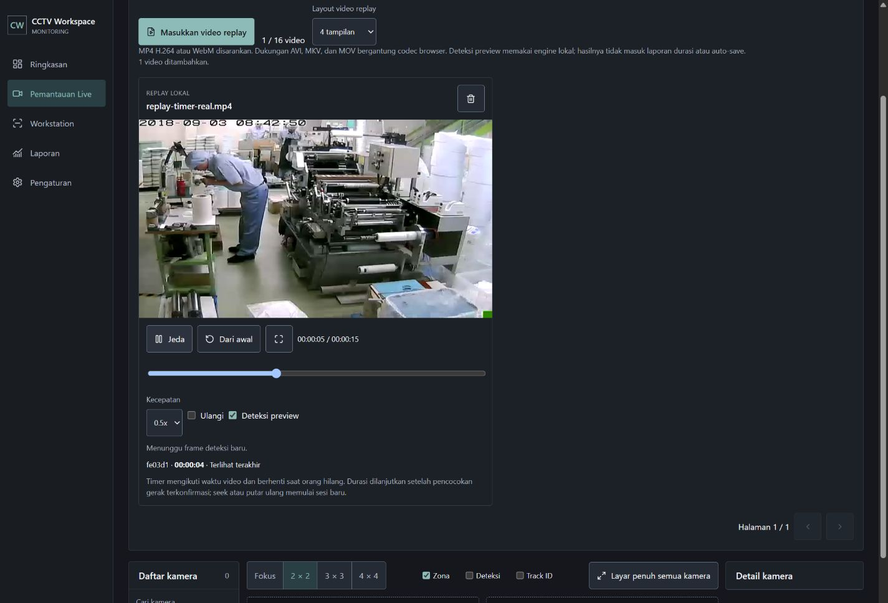

# Timestamp sesi pada replay

Mengganti jalur deteksi stateless untuk klien replay baru dengan sesi tracking
di RAM. Setiap file memiliki ByteTrack dan SessionManager terpisah. Label box
memuat ID sesi singkat dan durasi `HH:MM:SS`; ringkasan di bawah video mempertahankan
durasi terakhir saat pause atau LOST. Klien lama tanpa envelope tetap bisa
memakai deteksi stateless. Ini memperbarui batas fitur pada fix-009.

Timer mengikuti media time. Perubahan raw track ID tidak otomatis membuat timer
baru. Pemulihan memakai aturan konservatif aplikasi yang sudah ada: 3,5 detik
jendela gerak, tiga observasi konfirmasi, retensi LOST 10 detik pada konfigurasi
bawaan. Gap yang tidak teramati tidak dihitung. Kandidat belum terkonfirmasi
menampilkan status pencocokan. Keluar frame, orang diam yang hilang, kehilangan
panjang, atau crossing ambigu tetap dapat memecah sesi; tidak ada klaim ReID.

Pause, perubahan kecepatan, serta hide mempertahankan sesi. Seek, Dari awal,
dan loop ke awal membuat generasi timeline baru. Envelope file/generasi/urutan
serta media time diperiksa oleh server dan klien; permintaan lama ditolak sebelum
inferensi. Replay tidak dapat dialihkan ke accounting lewat header sesi live.
Registry dibatasi 64 file, idle 30 menit, dan batas sesi/history dari konfigurasi.
Sesi berada di RAM dan tidak bertahan setelah restart atau refresh browser.

Direction: panel monitoring CCTV yang padat, solid, tabular, mengikuti
DESIGN_SYSTEM.md. ENERGY 1 / RHYTHM 1 / MOTION 1. Tidak menambah aset visual.
Label opaque diperlukan agar waktu terbaca di atas footage terang maupun gelap;
warna memakai surface.video dan text.primary, sekitar 16:1 menurut rumus sRGB.
Ukuran label mengikuti skala viewport SVG agar huruf tetap sekitar 12 px pada
tile kecil. ResizeObserver dilepas saat unmount.

Verifikasi:

- 56 tes Python lulus pada replay tracking, sesi, webcam/API dan adapter MOT.
  Fixture 15 detik teramati, loss 3 detik, kembali dengan track ID baru memulihkan
  sesi dan menghasilkan 15,2 detik teramati. Ini bukti fixture, bukan akurasi
  recovery pada kamera lapangan. Tes lain memeriksa isolasi file, generasi seek,
  konflik urutan, pengganti diam, kapasitas registry, busy frame dan envelope rusak.
- 16 tes frontend lulus; production build berhasil setelah perubahan terakhir.
- Uji browser dengan engine OpenVINO CPU 8765 dan Vite 5173 memakai cuplikan nyata
  dari rekaman lokal 084248.mp4. AX memperlihatkan label `fe03d1 · 00:00:05`,
  satu deteksi confidence 86%, dan hasil 233 ms/frame pada satu pengamatan.
  Ini bukan benchmark. Timer tidak berubah ID setelah pause/resume yang diuji.
- Pada playback 0,5x, video berhenti di sekitar media 12,9 detik dengan durasi
  teramati 12 detik. Pause membersihkan box, tetapi ringkasan timer tetap ada.
  Dari awal mengembalikan currentTime=0, paused=true, tanpa row sesi atau box lama.
- Pemeriksaan DOM viewport 390 px menghasilkan document width 375 px; kontrol
  replay tetap tersedia. Capture screenshot viewport pada alat browser belum
  dipakai sebagai bukti layout native ponsel. Desktop dan ringkasan durasi
  ditangkap pada screenshot di bawah.
- Pada database replay-connected dan replay-connected-live, jumlah engine_runs
  dan person_sessions tetap nol setelah inferensi replay nyata.
- Pengujian Python pertama tertahan oleh pembatasan temp/event loop sandbox.
  Run final memakai direktori temp khusus di runtime dan izin proses lokal,
  lalu selesai 56 passed. Tidak ada kegagalan tes yang dibiarkan terbuka.

Delivery Gate untuk cakupan perubahan ini:

- PASS, Hard Gate: build, 56 tes Python dan 16 tes frontend; data durasi dari
  inferensi nyata serta fixture diberi cakupan yang jelas, tanpa metrik contoh.
- PASS, Purpose-Gate: label opaque dan angka tabular membuat durasi orang dapat
  dibaca pada footage; ID sesi memisahkan durasi dari raw track ID.
- PASS, Liveliness: ENERGY 1 / RHYTHM 1 / MOTION 1, satu accent tracking yang ada,
  video tetap pusat perhatian dan tidak ada dekorasi atau animasi tambahan.
- PASS, Craftsmanship: pause/resume/reset diperiksa di browser; generasi lama,
  timer salah orang, batas state dan isolasi accounting diperiksa oleh tes.

Detail kontrak: [Replay tracking](../docs/runtime/REPLAY-TRACKING.md).
