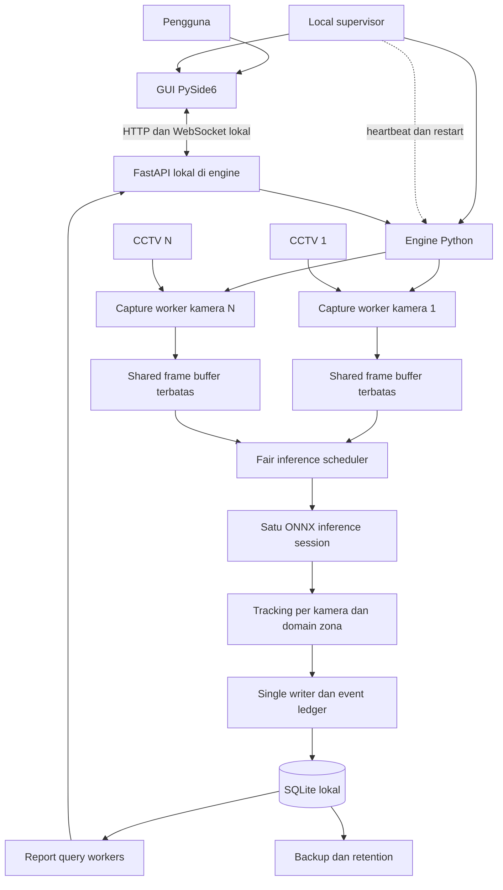
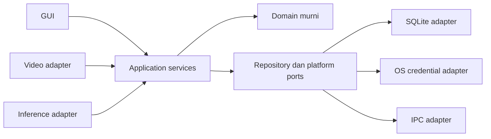

# Architecture — CCTV Productivity Tracker

Versi: 1.0 · 11 Oktober 2026 · Status: rancangan V1 untuk implementasi.

Basis produk: [PRD v1.3](../PRD-CCTV-Productivity-Tracker.md). Detail perilaku: [Technical Design](TECHNICAL-DESIGN.md). Skema referensi: [001_initial.sql](database/001_initial.sql). Delivery: [Implementation Plan](IMPLEMENTATION-PLAN.md).

## 1. Keputusan utama

Aplikasi menggunakan satu codebase Python dengan modul domain terpisah, satu SQLite lokal, dan proses terpisah untuk lifecycle, engine, GUI, serta capture setiap kamera. Model inference dimuat satu kali per engine/GPU, bukan satu kali per kamera.

Ini tetap aplikasi satu mesin. V1 tidak membutuhkan server cloud, message broker, atau database server. Boundary proses dipakai untuk responsivitas dan isolasi kegagalan native decoder; boundary modul dipakai agar komponen dapat diuji dan diganti.

| Keputusan | Alasan dan konsekuensi |
|---|---|
| Python + PySide6 | Mengikuti keputusan pengguna; GUI dan application logic cepat diubah saat pilot |
| Engine terpisah dari GUI | Menutup atau membuka ulang dashboard tidak memutus pencatatan |
| Supervisor lokal | Menjaga satu instance engine, memonitor heartbeat, dan memulihkan crash |
| Capture process per kamera | Decoder yang hang dapat dihentikan tanpa menghentikan kamera lain |
| PyAV/FFmpeg untuk decode | Stream dibuka melalui API dengan timeout; kredensial tidak dikirim sebagai argumen CLI |
| Satu inference session | Mengendalikan penggunaan VRAM; scheduler membagi kesempatan antar kamera |
| Frame buffer terbatas | Frame lama boleh dibuang; metadata accounting yang belum committed tidak boleh diam-diam hilang |
| Interval zona menjadi sumber metrik | Occupancy meja tidak digandakan ketika dua track hadir sekaligus |
| Event ledger + checkpoint | Perubahan dan batas durabilitas dapat ditelusuri; kehilangan setelah crash terlihat sebagai unknown |
| Single SQLite writer | Semua perubahan domain dan projection berkomit dalam transaksi terkontrol |
| Aggregate sebagai cache | Daily sampai yearly dapat dibangun ulang selama detail sumber masih tersedia |

## 2. Topologi runtime



Pada pilot N kamera terdapat supervisor, engine, GUI opsional, dan N capture workers. Internal engine memakai thread untuk writer, inference, control IPC, serta query/maintenance. Tidak ada proses inference per kamera. Supervisor bukan GUI; tetap hidup saat jendela ditutup. Autostart OS/Windows service bukan bagian V1, sehingga logout/reboot tetap memerlukan startup aplikasi atau integrasi deployment berikutnya.

Semua entry point dibuat aman untuk `spawn`; native runtime dimuat di proses yang memakainya. Gunakan `multiprocessing.get_context("spawn")` secara eksplisit dan pengujian frozen executable. Dokumentasi Python menjelaskan perbedaan start method dan risiko proses yang dihentikan saat mengakses queue/lock. [Python multiprocessing](https://docs.python.org/3/library/multiprocessing.html).

## 3. Kepemilikan state

| State/resource | Pemilik | Pembaca/pengguna |
|---|---|---|
| Engine instance lock dan restart policy | Supervisor | GUI/engine lifecycle |
| Secret kamera | CredentialStore engine | Capture worker melalui channel privat |
| Shared memory dan registry worker | Engine, supervisor mengetahui registry | Capture writer dan inference reader |
| Detector/session GPU | Inference thread engine | Scheduler |
| Tracker | Satu domain context per camera generation | Zone association |
| Zone state machine | Coordinator engine | Writer melalui immutable batch |
| SQLite write connection | Writer thread | Domain, config, agregasi, maintenance melalui command queue |
| SQLite read connection | Masing-masing query worker engine | API/report/aggregation |
| Qt widgets | Main thread GUI | Signal/slot dari background workers |

Setiap koneksi database dibuat dan digunakan oleh thread pemiliknya. Widget hanya diubah di main thread. [Qt threading rules](https://doc.qt.io/qt-6/threads-qobject.html).

## 4. Tiga jalur komunikasi

**Data plane:** capture menulis frame ke buffer shared memory berkapasitas tiga slot. Inference mengambil frame terbaru sesuai jadwal. Slot lama yang belum dipakai boleh ditimpa; slot sedang dibaca tidak boleh ditimpa. Consumer menyalin frame terpilih ke working buffer, lalu melepas slot sebelum inference. Shared memory mengurangi serialization antarpocess, tetapi desain ini bukan klaim zero-copy ke GPU. [Python shared memory](https://docs.python.org/3/library/multiprocessing.shared_memory.html).

**Accounting plane:** hasil inference menjadi observasi zona dan batch domain, lalu transaksi SQLite. Queue ini terbatas, tetapi tidak memakai kebijakan drop-frame. Bila writer tidak sanggup mengikuti atau disk gagal, engine menghentikan finalisasi accounting, memberi status persistence degraded, dan pemulihan mencatat unknown dari checkpoint committed terakhir.

**Control/query/preview plane:** GUI dan engine memakai FastAPI + Uvicorn pada TCP loopback, JSON HTTP untuk command/query, serta WebSocket untuk status dan preview JPEG. Satu server worker menjaga satu engine/session inference. Token per instance dan schema/version validation wajib. Preview dapat dibuang dan terpisah dari accounting. GUI tidak membuka SQLite atau mengirim SQL, kode Python, pickle, atau path untuk dieksekusi. Endpoint hanya bind `127.0.0.1`; remote access mengikuti desain V2. [API Design](API-DESIGN.md) dan [OpenAPI](api/openapi.json) menjadi kontrak.

Standardisasi HTTP menggantikan protokol framing custom agar lebih mudah diuji dan dikembangkan. Async API hanya menangani I/O dan delegasi; inference dan sqlite3 tidak dijalankan sebagai blocking call pada event loop. [FastAPI concurrency guidance](https://fastapi.tiangolo.com/async/).

## 5. Boundary modul



Domain berisi interval, state transition, schedule clipping, aggregation, serta identity-source semantics. Domain tidak mengimpor PySide6, PyAV, ONNX Runtime, atau sqlite3. Application services mengatur use case; adapters menyediakan I/O. Interface cukup berupa Python Protocol/dataclass, tanpa framework dependency injection wajib.

Struktur implementasi yang diusulkan:

```text
src/cctv_tracker/
  bootstrap/       supervisor, entry points, instance registry
  domain/          observations, zones, intervals, schedules, metrics
  application/     engine coordinator, config, reports, maintenance
  ports/           detector, decoder, clock, repositories, credentials
  adapters/
    video/         PyAV capture, frame buffer
    inference/     ONNX, preprocessing, output parser
    tracking/      ByteTrack adapter
    persistence/   SQLite writer, migrations, queries
    api/           FastAPI routes, validation, WebSocket, local authentication
    ipc/           capture/supervisor channels dan frame descriptors
    platform/      process ownership, paths, credential store
  gui/             Qt Widgets, view models, background query workers
  resources/       defaults dan model manifests
tests/             domain, database, IPC, replay, fault injection
```

## 6. Perbaikan terhadap PRD

1. **Metrik berasal dari interval zona**, sementara track hanya membantu observasi; track bukan employee.
2. **Count dan presence dipisah:** occupied dengan count yang belum pasti tetap mempunyai presence; count menjadi unavailable.
3. **Unknown mencakup pending confirmation, gap inference, persistence failure, dan downtime**, bukan hanya RTSP offline.
4. **Close GUI berbeda dari stop engine**; kendali stop memiliki acknowledgment dan batas shutdown.
5. **Kalender dan konfigurasi berversi**, termasuk timezone dan schedule; histori tidak berubah karena settings terbaru.
6. **Satu tabel aggregate ber-grain** menggantikan empat skema hampir identik; rasio dihitung dari denominator tersimpan.
7. **Retention menyatakan kemampuan laporan:** data lama dengan hanya cache tidak dapat menjanjikan drill-down atau custom range exact.
8. **Model artifact, coordinate transforms, dan frame generation eksplisit**, agar salah overlay/model tidak menghasilkan metrik yang tampak valid.

## 7. Jalur scaling dan keputusan yang ditunda

V1 dimulai satu kamera CPU untuk membuktikan domain, lalu 1–4 kamera, baru profiling ke target lebih besar. CUDA menjadi mode deployment tersendiri; fallback CPU terlihat dan dapat ditolak jika tidak memenuhi target. TensorRT, micro-batching, hardware decode, dan C++ hanya ditambahkan setelah benchmark menunjukkan keuntungan.

PyAV timeout, shared-memory ownership, platform process cleanup, model license/artifact, serta packaging Windows/Linux adalah spike wajib. Output desain bukan bukti bahwa 20 kamera sudah tercapai. ONNX Runtime menyediakan execution provider dan profiling pada API Python. [ONNX Runtime Python API](https://onnxruntime.ai/docs/api/python/api_summary.html).

Linux frozen multiprocessing memiliki perhatian khusus, sehingga spike packaging harus memilih antara bundle interpreter terkontrol atau executable yang teruji; tidak menganggap build Windows dapat dipakai langsung pada Linux. [PyInstaller multiprocessing guidance](https://pyinstaller.org/en/stable/common-issues-and-pitfalls.html).

PostgreSQL, multi-site, public API, SSO, employee identity verification, serta OS service tetap mengikuti rilis berikutnya. Python dapat tetap menjadi engine produksi ketika acceptance gate terpenuhi.
