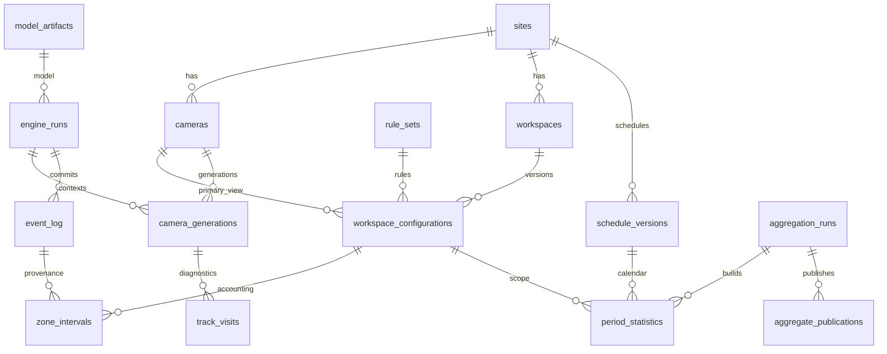

# Database Design — SQLite V1

Versi: 1.0 · 11 Oktober 2026. Skema referensi executable: [001_initial.sql](database/001_initial.sql).

## 1. Source of truth dan model data

SQLite berada di disk lokal mesin engine. Event ledger merekam perubahan domain dan checkpoint; zone_intervals merupakan projection canonical untuk metrik; period_statistics merupakan cache laporan. Track visits menjadi metadata diagnostik, bukan bukti identitas atau sumber utilization.

Rancangan V1 tidak menambahkan employees/RBAC/biometric tables sebelum fitur identitas V1.5 dibutuhkan. Ini menghindari employee_id palsu dari track ID.

## 2. Data dictionary

| Tabel | Fungsi dan aturan penting |
|---|---|
| schema_migrations | Riwayat versi skema dan checksum file migration pada manifest installer |
| database_state | Identitas database epoch; berubah setelah restore agar client lama tidak menulis ke instance yang salah |
| sites | Lokasi; V1 satu lokasi, key tersedia untuk future scope |
| cameras | Endpoint tanpa secret, credential_ref, revision dan runtime settings |
| model_artifacts | Hash unik, lokasi artifact, input/output/license manifest |
| rule_sets | Settings immutable: thresholds, quality, debounce, geometry rules |
| schedule_versions | Timezone dan kalender berversi, effective-time |
| workspaces | Identitas zona, jenis, kapasitas, exclusive_group, lifetime monitoring |
| workspace_configurations | Kamera utama, polygon normalized, scene reference, rule version, masa berlaku |
| engine_runs | Model/version runtime, start/stop dan termination reason |
| camera_generations | Namespace tracker yang berubah pada reconnect/restart |
| event_log | seq global, event_id unik, producer_seq per run, typed JSON payload |
| command_receipts | Hasil mutation yang sudah committed untuk idempotency API |
| zone_intervals | Interval state/count, evidence watermark, provenance event |
| track_visits | Rentang track berada di zona, anonymous pada V1 |
| aggregation_runs | BUILDING/PUBLISHED/FAILED, source sequence dan calendar/metric manifest |
| period_statistics | Durasi exact, count integral, session starts, cache grain |
| aggregate_publications | Pointer publication aktif per workspace/grain/calendar label |
| api_jobs | Status pekerjaan panjang; parameter hanya public config atau secret reference |
| backup_jobs | Manifest backup, verification dan error |
| maintenance_jobs | Riwayat rebuild/retention/restore/migration |

JSON hanya untuk config immutable dan payload typed yang fleksibel. FK, timestamps, state, identity scope, serta field query utama tetap kolom relasional. Application validator menolak unknown keys, polygon tidak valid, tipe salah, serta hubungan beda site. `json_valid()` hanya memeriksa sintaks JSON, bukan domain schema.

## 3. Units, keys, dan null semantics

ID domain berupa UUID string; seq ledger INTEGER autoincrement. Timestamp dan durasi disimpan INTEGER UTC microseconds. Timestamp API berupa RFC3339 dengan offset; metadata durasi API menyatakan unit. Runtime monotonic timestamp tidak dipakai sebagai timestamp laporan.

Semua interval [start,end). end NULL berarti interval aktif, bukan durasi tak terbatas. evidence_until merupakan batas yang sudah diakui; query active known berhenti di sana. Missing interval/tail eligible menjadi unknown.

Count semantics:

- EMPTY wajib observed_count = 0.
- UNKNOWN wajib observed_count NULL dan reason terisi.
- OCCUPIED boleh count >= 1 atau NULL jika keberadaan jelas tetapi jumlah belum dapat dipercaya.
- Count melebihi kapasitas tetap dapat dicatat; kapasitas bukan alat menghapus observasi.
- N/A pada ratio adalah SQL NULL/API null, bukan nol.

## 4. Invariant SQL dan application

SQL menegakkan FK workspace/config yang cocok, state/count consistency, durasi positif, equality P+A+U=T, satu interval open per zona, dan penolakan overlap insert/update. Partial index digunakan untuk constraint active row. [SQLite partial indexes](https://www.sqlite.org/partialindex.html).

Application tetap wajib memeriksa kontinuitas eligible, UTC monotonic, polygon simple dan area positif, konfigurasi/schedule non-overlap, camera/workspace berada pada site sama, dan payload event/sequence cocok. Constraint SQL tidak menggantikan domain validation.

Konfigurasi immutable kecuali menutup effective_to ketika superseded. Workflow config: validasi proposed revision → ledger event + close config lama + insert revision baru dalam transaksi → worker generation/model compatibility acknowledgment → activation gap unknown sampai observasi terkonfirmasi. Client harus mengirim expected revision melalui If-Match.

## 5. Contoh accounting tanpa double count

Untuk satu desk:

| Interval | State | Count |
|---|---|---|
| [09:00,09:30) | OCCUPIED | 1 |
| [09:30,10:00) | OCCUPIED | 2 |
| [10:00,10:05) | UNKNOWN | NULL |
| [10:05,11:00) | EMPTY | 0 |

Durasi presence = 60 menit, bukan 90 menit. Occupancy integral = 90 person-minutes. Unknown = 5 menit; empty = 55 menit. Total = 120 menit. Dua occupied segments bersebelahan tetap satu occupied session; unknown memutus session berikutnya.

View occupied_sessions menggabungkan occupied segments bersebelahan pada config sama. Diagnostic track_visits mungkin overlap, tetapi tidak dipakai untuk menjumlah presence.

## 6. Write transaction dan durabilitas

Writer connection: foreign_keys=ON, journal_mode=WAL pada local file, synchronous=FULL sebagai baseline durability, busy_timeout awal 2000 ms. Configure per connection dan verifikasi hasil PRAGMA. Semua runtime readers juga mengaktifkan FK bila menulis tidak sengaja dicegah melalui mode read-only/query_only.

Gunakan transaksi explicit BEGIN IMMEDIATE untuk batch domain. Jangan bergantung pada implicit transaction defaults yang berubah antar runtime. Writer tidak berbagi connection lintas thread. UI/API tidak menulis database sendiri.

Mutation order: tutup interval lama → insert interval pengganti → ledger/projection batch memastikan event parents tersedia → receipt/job → COMMIT. Dalam implementasi ledger inserts dilakukan sebelum projection yang mereferensikannya. Publikasi acknowledgment hanya sesudah commit.

Duplicate event_id/producer_seq dibandingkan dengan payload hash/version; identik adalah retry, berbeda adalah error. Semua batch rollback jika satu projection melanggar invariant. Idempotency receipt dan efek command berada dalam transaksi yang sama.

WAL memungkinkan readers berjalan bersama writer, tetapi tetap memiliki satu writer dan checkpoint constraints. Reader tidak membuka transaksi panjang sambil GUI menunggu pengguna. [SQLite WAL](https://www.sqlite.org/wal.html), [SQLite foreign keys](https://www.sqlite.org/foreignkeys.html).

## 7. Query patterns dan indexes

| Use case | Akses |
|---|---|
| Workspace timeline | workspace_id + start range, trim end pada application |
| Replay per run | engine_run_id + producer_seq; event seq global menjaga ordering publication |
| Occupied sessions | View untuk exact range; cache session starts untuk summary |
| Period report | publication pointer → aggregation_run PUBLISHED → statistics matching scope |
| Job queue | status + created time |
| Camera current config | workspace active configuration partial index |

Predicate overlap: start_utc_us < query_end AND effective_end > query_start. Interval sebelum query_start tetap harus dicari karena dapat memanjang ke range. Gunakan per-workspace index dan predecessor lookup; jangan hanya filter start >= query_start.

Query produk menggunakan bound parameters dan allowlist sorting/filter. Tidak ada raw SQL API. EXPLAIN QUERY PLAN dan dataset histori digunakan untuk memvalidasi index; target report p95 2 detik bukan hasil validation skema.

## 8. Cache publication dan konsistensi

aggregation_runs berisi source event high-watermark, metric version, schedule versions, timezone/tzdata manifest, serta build status. Candidate rows boleh ditulis per chunk, tetapi tidak terlihat sebelum pointer publication diarahkan ke run PUBLISHED dalam transaksi.

Cache berbeda config/schedule pada hari sama tersimpan sebagai partitions. eligible_us hanya intersection masa berlaku partition, bukan seluruh bucket berulang. Statistik akhirnya menjumlah partitions; ratio dihitung setelah penjumlahan numerator/denominator.

Count peak tidak dijumlahkan antar hari/zone. Session starts dijumlahkan per bucket tempat session benar-benar mulai; duration custom range dapat termasuk session yang dimulai sebelumnya tanpa menaikkan session_starts.

Live report mencatat source_event_seq, durable_until, provisional flag, freshness, detail availability, serta count coverage. Publication lama dapat tetap dipakai bila dilabeli stale; source interval menyediakan refresh exact selama retained.

## 9. Snapshot untuk API dan export

Report query melakukan satu read transaction pendek lalu melepaskan SQLite connection. Pagination memakai hasil yang telah dimaterialisasi dengan snapshot_id TTL 60 detik, quota memori 32 MiB total, maximum 5000 rows/snapshot. Cursor mengikat snapshot/filter/order dan posisi terakhir; restart/expiration menghasilkan SNAPSHOT_EXPIRED, bukan page dari snapshot baru.

Laporan lebih besar menjadi export job. Job membuat SQLite backup snapshot sementara yang sudah divalidasi dan disk-budget checked, membaca hasil secara chunk dari snapshot, menulis CSV.tmp, lalu rename hasil final. Metadata source sequence dan filter disimpan. Snapshot temp dihapus setelah job selesai/gagal; tidak mengunci reader live sepanjang export.

File result diakses berdasarkan job ID. Client tidak memilih arbitrary source/destination path melalui API. GUI dapat menyimpan hasil download ke lokasi pilihannya di luar engine.

## 10. Retention dan migration

Retained detail awal 1 tahun; caches 3 tahun; backup 30 hari. Event/config/model anchors yang masih direferensikan cache/retained rows perlu dipertahankan sebagai metadata minimal. Policy 1 tahun berlaku untuk detail yang dapat ditelusuri, bukan janji menghapus semua baris FK anchor tepat pada ulang tahun. detail_available/history_start metadata menjelaskan horizon setiap report.

Sebelum prune, pastikan cache target sudah published dan recovery baseline tersedia. Hapus track visits, intervals, dan event yang tidak lagi direferensikan dalam chunk. Jangan mematikan FK supaya delete lolos. Penambahan correction/identity V1.5 membutuhkan policy retention tersendiri.

Migration memakai file bernomor dan hash manifest, pre-migration verified backup, lock maintenance dan schema version gate. Migration additive lebih dahulu; database lebih baru dari binary tidak dibuka untuk processing. Destructive rollback berarti restore verified backup, bukan reverse SQL yang belum diuji.

## 11. Backup/restore dan schema validation

Backup menggunakan API SQLite yang konsisten, bukan copy file .db aktif tanpa memperhatikan WAL. Verify quick_check/integrity_check, foreign_key_check, file checksum, dan manifest. [SQLite Online Backup API](https://www.sqlite.org/backup.html).

Restore tervalidasi ke staging, pause engine, close connections, pre-restore backup, controlled swap, lalu restart/recovery. CredentialStore tidak otomatis dipulihkan dari database.

Validation referensi: [validate_design.py](validation/validate_design.py) memuat skema pada SQLite, menguji FK/checks/overlap/session grouping/ratio, serta backup round trip. [Results](validation/RESULTS.md) mencatat hasil aktual. Ini memverifikasi rancangan database, bukan runtime CCTV, performa, atau correctness state machine yang belum diimplementasikan.
