# Technical Design — Python V1

Versi: 1.0 · 11 Oktober 2026 · Status: desain, belum aplikasi berjalan.

Referensi: [Architecture](ARCHITECTURE.md), [Database Design](DATABASE-DESIGN.md), [API Design](API-DESIGN.md), [Delivery Plan](IMPLEMENTATION-PLAN.md).

## 1. Invariant sistem

1. Untuk satu workspace, interval canonical tidak overlap.
2. Dalam periode eligible: occupied + empty + unknown = eligible duration.
3. Count tidak menggandakan durasi occupied.
4. Track ID hanya unik dalam camera generation, tidak menjadi employee ID.
5. Hanya data yang committed dinyatakan durable; tail live ditandai provisional.
6. Semua state mutation diproses coordinator berurutan dan ditulis oleh satu writer.
7. Frame boleh dibuang; kehilangan accounting dinyatakan sebagai unknown.
8. Deadline menggunakan monotonic clock; penyimpanan menggunakan UTC microseconds.
9. Query dan config selalu membawa versi yang relevan.
10. GUI tidak menjadi pemilik lifecycle engine atau koneksi database.

## 2. Baseline stack dan konfigurasi

Python + PySide6/Qt Widgets + PyQtGraph + PyAV/FFmpeg + OpenCV/NumPy + ONNX Runtime + ByteTrack adapter + sqlite3 + FastAPI/Uvicorn. Baseline model berupa artifact ONNX lokal beserta manifest. Kandidat versi Python dan dependency divalidasi bersama pada spike Windows/Linux dan GPU; lockfile mengikuti hasil spike, bukan asumsi semua versi terbaru kompatibel.

GUI menggunakan model/view Qt untuk tabel, PyQtGraph untuk line/bar/heatmap, dan custom Qt widget untuk occupancy timeline serta polygon editor. Query berada pada background worker; hasil immutable dikirim ke main thread melalui Qt signals. PyQtGraph mendukung PySide/NumPy; versi stable yang kompatibel dipilih pada spike, bukan langsung memakai development branch. [PyQtGraph](https://pyqtgraph.readthedocs.io/en/latest/).

Settings dipisah menjadi bootstrap settings lokal, kamera berversi, rule set immutable, model manifest immutable, schedule berversi, serta UI preferences. Secret tidak menjadi bagian file config.

Nilai awal berikut adalah konfigurasi pilot, bukan klaim akurasi/performa:

| Parameter | Nilai awal | Tujuan |
|---|---|---|
| inference_target_fps | 5/kamera | Sampling untuk presence |
| occupied_confirm_seconds | 2 | Konfirmasi observasi occupied |
| empty_confirm_seconds | 5 | Konfirmasi empty lebih konservatif |
| max_evidence_gap_seconds | 1 | Batas continuity antar hasil inference |
| durable_checkpoint_seconds | 1 | Batas tail yang belum tersimpan saat writer sehat |
| capture_open_timeout_seconds | 10 | Batas pembukaan stream |
| capture_read_timeout_seconds | 5 | Batas pembacaan decoder |
| frame_stale_seconds | 1 | Frame untuk inference sudah terlalu lama |
| capture_restart_deadline_seconds | 8 | Restart bila worker tidak menghasilkan progress |
| preview_fps | 2, kamera yang sedang ditampilkan | Beban GUI terpisah |
| frame_slots | 3/kamera | Bound memory dan ownership sederhana |
| reconnect_backoff_seconds | 1, 2, 4, 8, 16, 30 + jitter | Menghindari retry loop |
| db_commit_budget_ms | 250 | Budget batching; tidak memperpanjang checkpoint tanpa status degraded |
| control_request_timeout_seconds | 5 | Command biasa; pekerjaan panjang menjadi job |

Detection thresholds, overlap thresholds, dan model input size mengikuti model manifest serta kalibrasi scene. Capacity kamera ditentukan benchmark, bukan nilai konfigurasi default.

## 3. Capture dan frame transport

Capture worker membuka RTSP menggunakan PyAV dengan transport TCP sebagai default yang diuji, open/read timeout, serta konfigurasi decoder terbatas. PyAV mengekspos timeout pembukaan/pembacaan. [PyAV API](https://pyav.org/docs/stable/api/_globals.html).

FrameDescriptor internal memuat engine_run_id, camera_id, generation_id, frame_seq, decoded_monotonic_ns, mapped_utc_us, source_pts jika ada, width/height/stride, pixel_format, slot, dan slot_generation. Frame bytes tidak menjadi JSON.

Buffer tiga slot memiliki state FREE/WRITING/READY/READING di bawah lock dengan acquisition timeout. Producer mengambil FREE atau READY paling lama; tidak menyentuh READING. Consumer memilih READY terbaru, menandainya READING, menyalin bytes ke buffer miliknya, lalu melepas slot. Descriptor dan bytes dipublikasikan bersama setelah frame lengkap. Konsumen tidak membaca buffer tanpa ownership.

Jika lock/worker mati, jangan memakai kembali lock atau shared memory generation tersebut. Tutup context kamera, tandai unknown, stop worker yang dimiliki aplikasi, kemudian buat channel/lock/buffer baru. Registry owner dan cleanup diuji khusus di Windows/Linux. Tidak menganggap terminate proses membuat queue/lock aman dipakai kembali.

Worker melakukan decode berkelanjutan agar buffer backend tidak sengaja menumpuk; publishing inference/preview disampling. Ini tidak membuktikan bahwa seluruh biaya decode hilang ketika inference FPS diturunkan. Hardware decode/substream dievaluasi kemudian.

Host decoded time adalah waktu observasi pada mesin, bukan bukti waktu capture sebenarnya di sensor. PTS discontinuity, frozen image, perubahan ukuran/aspect, atau latency backend yang terdeteksi menurunkan quality. Tanpa clock kamera terkalibrasi, laporan tidak mengklaim latency capture-to-host exact. Frozen-frame heuristic tidak boleh menganggap scene diam selalu berarti kamera rusak.

## 4. Inference, tracking, dan koordinat

Scheduler memilih kamera secara round-robin berdasarkan deadline; maksimal satu frame per kamera sedang in-flight. Kamera dengan input buruk tidak memonopoli worker. Hasil terlambat melewati deadline, generation berubah, atau config/model version berbeda dibuang dari accounting dan dihitung pada health metrics.

Inference session dimuat sekali. Baseline CPU provider untuk functional test; deployment CUDA memakai provider eksplisit dan health menyatakan provider aktual. Model tidak dimuat ulang pada setiap frame/request. Thread-pool ONNX dikonfigurasi agar banyak komponen tidak oversubscribe CPU. Profiling dan I/O binding merupakan opsi optimasi setelah baseline. [ONNX Python API](https://onnxruntime.ai/docs/api/python/api_summary.html).

Model manifest mencatat sha256, asal/license artifact, model version, person class IDs, input layout/type/shape, resize/letterbox policy, normalization, output parser version, NMS policy, dan supported providers. Aplikasi tidak mengunduh weights saat runtime. Parser menolak output schema yang tidak cocok.

Detector menghasilkan bbox pada koordinat frame original setelah inverse letterbox/scale. GUI editor menyimpan polygon normalized [0,1] terhadap frame original beserta reference dimensions dan scene fingerprint. Rotasi/aspect berubah atau kamera dipindahkan mengharuskan zone review. Overlay selalu memakai frame_seq yang sama dengan detection atau diberi label stale; tidak menggambar bbox lama pada frame baru tanpa penjelasan.

Tracker per generation memakai delta waktu nyata karena inference FPS bisa berubah. Prediksi tracker yang belum mendapat detection baru tidak memperpanjang bukti presence melewati max_evidence_gap. Low-score association dapat menjaga track continuity, tetapi bukan bukti occupied yang setara dengan observasi kuat.

Untuk desk, polygon menggambarkan volume area penghuni yang terlihat, bukan hanya permukaan meja. Kalibrasi memilih score overlap bbox/polygon dan ambiguity margin. Dalam exclusive_group meja bersebelahan, satu track hanya dipetakan ke satu meja terbaik; tie menjadi ambiguous. Room/area dapat overlap dengan desk secara hierarkis, sehingga total headcount tidak boleh dijumlahkan lintas jenis zona. Total workstation utilization menggunakan desk-seconds.

## 5. Observation contract dan quality gate

Observation merupakan input domain kecil, tanpa frame atau secret. Kontrak machine-readable: [zone-observation.schema.json](contracts/zone-observation.schema.json).

Input memuat workspace/config/camera/generation/frame IDs, monotonic observation time, mapped UTC, evidence OCCUPIED/EMPTY/UNKNOWN, observed_count nullable, serta reason code. Tidak menyatakan probability employee.

Occupied memerlukan detection/association yang memenuhi rule. Empty memerlukan frame fresh, inference berhasil, scene/ROI valid, tidak ada association ambiguous, dan absence kandidat yang melewati confirmation. “Tidak ada detection” tetap mempunyai kemungkinan false negative; akurasi empty diuji pada pilot.

UNKNOWN reason codes: STARTUP, PENDING_CONFIRMATION, CAMERA_OFFLINE, FRAME_STALE, INFERENCE_TIMEOUT, QUALITY_LOW, ZONE_AMBIGUOUS, SCENE_CHANGED, PERSISTENCE_GAP, ENGINE_INTERRUPTED, CONFIG_CHANGE, CLOCK_DISCONTINUITY. Occupied dapat memiliki count unavailable jika presence jelas tetapi cardinality belum pasti.

## 6. State machine dan waktu accounting

Domain menerima observasi urut monotonic per workspace. Duplicate/out-of-order frame_seq dari generation sama tidak diterapkan kembali. UTC interval disusun dari engine clock mapping yang sama.

```mermaid
stateDiagram-v2
  [*] --> UNKNOWN
  UNKNOWN --> OCCUPIED: occupied konsisten melewati confirmation
  UNKNOWN --> EMPTY: empty konsisten melewati confirmation
  OCCUPIED --> UNKNOWN: bukti berbeda, kualitas hilang, atau evidence gap
  EMPTY --> UNKNOWN: bukti berbeda, kualitas hilang, atau evidence gap
  OCCUPIED --> OCCUPIED: bukti valid berlanjut; count dapat berubah
  EMPTY --> EMPTY: bukti valid berlanjut
```

Aturan konservatif dipilih untuk V1: **periode menunggu konfirmasi dihitung UNKNOWN; status baru mulai saat konfirmasi, tanpa backdating**. GUI boleh menampilkan candidate/last known state, tetapi durasi report tetap mengikuti interval canonical.

| Kondisi | Perubahan canonical |
|---|---|
| Bukti konsisten dengan state known | Extend evidence watermark sampai observasi baru |
| Bukti kuat berbeda pada t | Tutup state sebelumnya pada t; buka UNKNOWN pending |
| Kandidat konsisten hingga confirmation | Tutup UNKNOWN pada t_confirm; buka state baru |
| Kandidat batal/kualitas buruk | UNKNOWN tetap berlaku; konfirmasi ulang diperlukan |
| Quality gate hilang sebelum kandidat valid | Tutup known pada evidence watermark terakhir; mulai UNKNOWN |
| Gap > max_evidence_gap | Tutup known pada evidence watermark terakhir; gap menjadi UNKNOWN |
| Count berubah tetapi presence tetap jelas | Split count segment saat count baru stabil; state tetap OCCUPIED |

Continuity antar dua observasi valid dapat diinterpolasi hanya jika gap tidak melewati batas, generation/config sama, serta quality gate lolos. Ini adalah metode estimasi teramati yang dievaluasi pilot, bukan rekonstruksi setiap frame yang tidak diproses.

Contoh: occupied sampai 10:00:00; empty kandidat mulai 10:00:01 dan terkonfirmasi 10:00:06. Rentang [10:00:01,10:00:06) adalah UNKNOWN. Ini menghindari mengubah durasi historis setelah confirmation terlambat.

Canonical interval adalah [start,end). Untuk interval terbuka, report hanya memakai [start,evidence_until); setelah watermark sampai query end menjadi unknown. Zero-length transient dihapus dari projection, tetapi event penyebab tetap dapat ditelusuri.

Session occupied merupakan gabungan segment OCCUPIED yang bersebelahan pada config sama. Perubahan count tidak menambah session; UNKNOWN/EMPTY/config boundary memutus session. Session count dapat lebih banyak pada observasi buruk, sehingga coverage dan unknown selalu ditampilkan.

## 7. Event, checkpoint, dan transaksi

Event types minimum: ENGINE_STARTED/STOPPED, CAMERA_LOST/RESTORED, OBSERVATION_LOST/RESTORED, ZONE_STATE_CHANGED, ZONE_COUNT_CHANGED, CONFIG_APPLIED, CHECKPOINT, RECOVERY_GAP, COMMAND_COMMITTED. ENTER/EXIT adalah label derived untuk transisi occupied, bukan sumber hitungan employee.

Event envelope: event_id UUID, engine_run_id, producer_seq monotonik, observed_utc_us, payload_version, dan typed payload. CHECKPOINT memuat evidence watermark serta projection mutation yang lengkap untuk zona yang berubah; tidak menyimpan frame/bbox setiap detik.

Writer memproses immutable batch dalam transaksi: insert event ledger → apply interval mutation → update command receipt/job bila ada → commit → acknowledgment. Konflik event_id/run+producer_seq hanya dianggap retry bila payload cocok; payload berbeda memunculkan invariant violation. Sequence ledger global menjadi referensi snapshot.

Checkpoints awal setiap 1 detik; enqueue bukan durability. UI menerima committed_event_seq/durable_until setelah COMMIT. Queue writer awal dibatasi 256 batch dengan payload size bound; budget dikalibrasi. Bila acknowledgment terlambat, state live boleh tetap tampil provisional, tetapi durasi belum diakui tidak ditambahkan ke laporan durable.

Ketika persistence gagal atau queue penuh: stop finalisasi domain, laporkan degraded, hentikan accumulation batch tanpa batas, dan resume dari committed checkpoint. Data setelah checkpoint sampai konfirmasi baru dinyatakan unknown. Tidak ada klaim zero-loss saat listrik padam.

Replay menggunakan event payload version + configuration/rule/model references. Projection rebuild menuju database sementara, menjalankan invariants, lalu dipublikasikan melalui maintenance. Retention membatasi replay ke history_start yang tercatat.

## 8. Clock dan kalender

Engine menyimpan anchor UTC dan monotonic saat start. Deadline/confirmation/duration menggunakan monotonic. Mapping ke UTC dicek terhadap wall clock secara periodik. Clock jump signifikan menutup epoch dan menandai unknown; jika waktu mundur melampaui akhir committed, accounting menunggu mapping kembali valid atau epoch dikalibrasi tanpa menghasilkan timestamp mundur. Akurasi waktu ditandai terdegradasi, bukan dipaksakan overlap.

ScheduleResolver memakai IANA timezone, weekday, exceptions/holidays, shifts, dan break windows. Interval overlap jadwal disatukan sebelum perhitungan. Shift overnight dipotong pada local midnight untuk grain DAY; shift label tetap metadata resolver. DST ambiguous local time membutuhkan fold eksplisit; nonexistent local time ditolak saat konfigurasi. Timezone/calendar change membuat versi effective-time baru.

Eligible time dibatasi intersection query, jadwal, monitoring lifetime, dan configuration lifetime. Sebelum workspace mulai dimonitor tidak dihitung unknown. Sebaliknya, downtime setelah monitoring aktif tetap masuk unknown pada jadwal eligible.

## 9. Aggregation dan reports

Aggregate durations dihitung dari intersection canonical intervals dan eligible windows. Gap di antara interval maupun tail setelah durable watermark diisi UNKNOWN. Source interval tidak perlu memuat seluruh downtime untuk query tetap benar.

COUNT integral = sum(observed_count × duration) untuk segment dengan count valid. Count coverage berbeda dari presence coverage. Average occupancy memakai count_known duration; unavailable tidak diisi nol. Peak lokasi memerlukan sweep timeline serentak dari zona reporting yang tidak overlap; menjumlah peak setiap zona menghasilkan angka yang salah.

Daily, weekly, monthly, yearly, dan optional five-minute bins memakai period_statistics dengan grain. Week dimulai Senin pada baseline. Denominator, source sequence, calendar/metric version dan detail_available disimpan. Ratios dihitung ketika query. Weekly/monthly/yearly duration dapat menjumlah daily partitions hanya jika versi dan eligible windows sama; peak tidak dijumlahkan.

Build cache dilakukan pada read snapshot, ditulis sebagai BUILDING aggregation run, lalu publish pointer dalam transaksi singkat. Query hanya menggunakan publication yang PUBLISHED. Freshness/retention disertakan di response; stale cache tidak disajikan sebagai current tanpa label.

Custom range exact memakai detail interval. Untuk detail yang sudah expired, API hanya menyediakan aligned cache bucket dengan resolution yang tersedia atau error RANGE_NOT_RECONSTRUCTABLE. Tidak melakukan prorata arbitrary range dari satu angka daily dan menyebutnya exact.

## 10. Recovery dan lifecycle

Startup: instance lock → schema/version check → recovery transaksi → load immutable config → validate model/provider → start API ready/degraded → start capture → confirmation baru. Schema yang lebih baru dari aplikasi memblokir start processing; API health dapat menjelaskan incompatibility.

Crash recovery menutup interval open known pada evidence_until terakhir dan membuat RECOVERY_GAP; tidak membawa OCCUPIED ke run baru. API job RUNNING yang tidak aman diulang menjadi INTERRUPTED. QUEUED hanya diulang bila job policy menyatakan aman. Export gagal tidak mengubah history.

Camera restart membuat generation baru dan tracker baru. Stale result/descriptor dari generation lama ditolak. Supervisor memonitor progress heartbeat yang mencakup writer/coordinator, bukan hanya thread API yang masih hidup. Native inference hang ditangani dengan restart engine; GUI reconnect dan accounting gap tetap unknown.

Supervisor menyimpan registry child process/creation identity dan shared resources, meminta shutdown graceful dahulu, baru menghentikan child yang benar-benar dimiliki aplikasi setelah timeout. Reuse PID atau nama shm bukan bukti kepemilikan. Implementasi platform ownership harus diuji dalam spike. Jika supervisor sendiri crash, instance lock dan stale registry ditangani saat start berikutnya.

Shutdown normal: stop accepting mutation → stop capture/scheduler → finalize evidence-safe boundaries → commit final checkpoint/ENGINE_STOPPED → drain writer → close API/model/DB → clean process/resources → supervisor acknowledges stopped. Menutup GUI hanya melepaskan subscriptions. User logout/power loss berbeda dari shutdown normal.

## 11. Backup, retention, dan restore

Backup memakai sqlite3.Connection.backup dari koneksi maintenance, checksum, PRAGMA quick_check + foreign_key_check, dan manifest schema/model/calendar/history horizon. Publish file final hanya setelah validasi berhasil. [Python sqlite3 backup](https://docs.python.org/3/library/sqlite3.html), [SQLite backup](https://www.sqlite.org/backup.html).

Restore meminta engine maintenance: pause accounting, hentikan semua database readers/writer, validasi backup pada path staging lokal, buat pre-restore backup, lalu swap database secara terkendali. Supervisor menghidupkan ulang engine setelah selesai. Backup tidak mengembalikan password kamera; credential_ref diverifikasi dan GUI meminta konfigurasi ulang bila secret tidak ada.

Retention berjalan per chunk dengan job status dan history_start. Aggregate lama tetap bisa dibaca jika sudah published. Event ledger/config references yang diperlukan detail retained tidak dihapus sembarang; baselines/config/model metadata tetap dipertahankan untuk horizon aktif. Operasi retention juga menghapus managed export/temp/backup sesuai policy tanpa menghapus source code.

## 12. Security, packaging, dan observability

API loopback tetap membutuhkan token karena proses lokal/browser dapat mengakses localhost. Token tidak di URL/log. CORS browser tidak diaktifkan; Host/Origin divalidasi. Model/schema input tidak dieksekusi sebagai Python/SQL. Secret memakai OS credential store; jika backend aman tidak tersedia, jangan fallback plaintext diam-diam. Akun OS yang sama tetap merupakan trust boundary V1, bukan isolasi antar pengguna aplikasi.

Data berada di application-data directory lokal di luar OneDrive/source. Logs structured dan berotasi, secret redaction diterapkan sebelum formatting exception. Metrics: capture age, inference age/FPS, queue depth, memory/VRAM, writer acknowledgment lag, event sequence, coverage, config version, provider aktual, reconnect count, report duration, backup age, stale cache count.

Windows/Linux build diuji masing-masing. Entry points memanggil freeze_support dan tidak melakukan spawn/model loading saat import. Packaging spike wajib memverifikasi multiprocessing di frozen executable; bundle tidak dijanjikan portable antar OS. ONNX/PyAV/Qt binaries, model artifact, GPU dependencies dan license manifest termasuk installation manifest.

## 13. Validation gates

Domain: transition fixture, pending unknown, gap, simultaneous count, monotonic clock jump, interval clipping, schedule overlap/DST, ratios N/A. Persistence: rollback/retry, overlap/foreign keys/checks, replay equivalence, source snapshot consistency, backup/restore. Runtime: malformed API payload, unauthorized request, stale generation, GUI reconnect, decoder hang, inference hang, disk full, writer queue pressure, parent/child crash, shutdown.

Report fixtures mempertahankan T=P+A+U dan sum daily durations sama dengan grouped periods. Benchmark membedakan CPU decode, inference/GPU, Python domain, memory copy, dan SQL. Soak test 24 jam merupakan gate pilot; hasil tidak disimpulkan dari validation skema desain.
