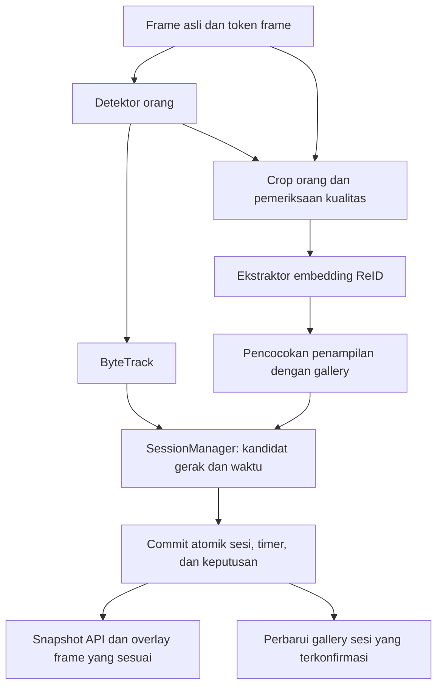

# Struktur implementasi Person ReID

Status terbaru: fondasi tahap 1 dan integrasi recovery aktif tahap 2 sudah
diimplementasikan. Tahap 3 tersedia sebagai policy short_occlusion eksperimental
khusus replay tanpa accounting; validasi lapangannya belum selesai.
Lihat [REID.md](REID.md) untuk konfigurasi, manifest, integrasi dan batas runtime.
Tahap 0 (baseline berlabel lengkap), validasi produksi, re-entry dan lintas kamera
belum selesai. Bagian berikut
mempertahankan rancangan target, termasuk pekerjaan tahap lanjut.
Dasar rancangan: kode `sessions.py`, `pipeline.py`, `live.py`, `persistence.py`,
`config.py`, serta migrasi `004_person_sessions.sql` yang diperiksa pada sesi ini.

## 1. Target awal

Satu kamera, satu run, satu generasi stream. ReID membantu mempertahankan sesi
anonim saat ada kehilangan deteksi singkat. Keluaran tetap `session_id`, bukan
nama karyawan. Kamera dan perangkat worker tetap seperti sekarang.

Prioritas: mencegah timer dan identitas sesi tertukar. Jika dua kandidat sama-sama
masuk akal, buat atau pertahankan sesi terpisah. Sesi yang terfragmentasi dapat
ditinjau; penggabungan salah langsung mencampur durasi dua orang.

Belum termasuk pengenalan nama, recovery setelah keluar kamera, reconnect,
pergantian pakaian, atau pencocokan lintas kamera. Semua itu perlu tahap dan
validasi tersendiri.

## 2. Alur data



ReID menyediakan bukti penampilan; `SessionManager` tetap memiliki keputusan
binding dan durasi. `ZoneAccumulator` tetap menjadi sumber rekap keterisian
area. Gallery menyimpan vektor ciri, bukan identitas karyawan.

Rekap area harian yang sudah ada tidak bergantung pada keberhasilan ReID.
`first_seen` sampai `last_seen` tidak boleh dijadikan durasi kerja.

## 3. Struktur modul yang direncanakan

Nama berikut adalah target file ketika tahap implementasinya dikerjakan.
File Python kosong dan migrasi belum dibuat pada tahap rancangan ini.

```text
src/cctv_tracker/
  reid/
    __init__.py
    types.py             # Token frame, sampel, embedding, keputusan
    config.py            # ReIdRules dan validasi konfigurasi
    crops.py             # Crop dari frame asli dan quality gate
    extractor.py         # Kontrak provider dan validasi output model
    openvino.py          # Implementasi provider OpenVINO
    gallery.py           # Sampel penampilan per sesi dengan TTL/kapasitas
    matcher.py           # Similarity, mutual best, margin, penolakan
    diagnostics.py       # Statistik dan alasan keputusan
  sessions.py            # Pemilik lifecycle/binding; integrasi matcher
  pipeline.py            # Korelasi frame, tracking, commit, publikasi
  live.py                # Menyediakan piksel frame sesuai deteksi
  video_replay.py        # Menyediakan frame dan media PTS untuk evaluasi
  config.py              # Settings.reid, pemuatan konfigurasi
  engine.py              # Factory provider opsional
  persistence.py         # Audit keputusan dalam transaksi checkpoint
  resources/
    005_reid_decisions.sql  # Hanya bila audit terstruktur dibutuhkan

models/reid/<model-version>/
  model.xml
  model.bin
  manifest.json

tests/
  test_reid_crops.py
  test_reid_extractor.py
  test_reid_gallery.py
  test_reid_matching.py
  test_reid_sessions.py
  test_reid_persistence.py

scripts/
  evaluate_reid.py        # Bandingkan baseline dan kandidat pada video berlabel
```

Tidak menambah tracker kedua. ByteTrack tetap digunakan; provider ReID tidak
membuat `session_id` atau menulis SQLite sendiri.

## 4. Kontrak data dan titik integrasi

| Data | Field wajib | Pemilik |
| --- | --- | --- |
| `FrameToken` | camera_id, run_id, generation_id, frame_seq, monotonic_ns, mapping_version | Pipeline |
| `AppearanceSample` | frame token, detection_index, box, kualitas crop | Penyedia frame/crop |
| `EmbeddingResult` | sample token, vector, model_id, model hash, preprocessing revision, quality | Ekstraktor |
| `MatchDecision` | candidate_session_id, target_session_id, action, appearance score, margin, reason, frame token, policy revision | Matcher/SessionManager |

`detection_index` hanya berlaku dalam frame tersebut. Dilarang menggunakan
`track_id` sebagai kunci identitas atau mengambil crop dari frame preview terbaru
yang kebetulan tersedia.

`live.py` saat ini memanggil `detector.detect(item['jpeg'])`, kemudian mengirim
deteksi ke `Pipeline.feed`. Piksel tidak diteruskan. Saat implementasi:

1. Bentuk satu envelope untuk frame, hasil deteksi, dan hasil embedding.
2. Crop memakai koordinat pada gambar asli; balikkan transformasi letterbox jika
   provider detektor mengembalikan koordinat model. Jangan crop dari anotasi UI.
3. Sediakan embedding sebagai argumen opsional bertipe pada `Pipeline.feed`.
   Pemanggil replay sintetis lama tetap bisa berjalan tanpa piksel/embedding.
4. Cocokkan embedding ke deteksi terukur yang dipakai tracker. Jangan mengasumsikan
   urutan output tracker selalu sama dengan urutan detektor, atau memakai box
   prediksi sebagai bukti visual baru.
5. Tolak envelope usang sebelum gallery, sesi, atau timer dimutasi.
6. Commit checkpoint, mapping, durasi, dan audit dalam satu transaksi. Baru setelah
   sukses, publikasikan snapshot dan terapkan pembaruan gallery yang disiapkan.

Pada tahap awal ekstraksi sinkron dan dibatasi anggarannya agar korelasi frame
sederhana. Jangan menambah worker paralel sebelum profil menunjukkan perlu.
Jika nanti async, hasil terlambat boleh dibuang, tidak boleh mengubah checkpoint
lama atau menghitung ulang timer dari callback.

## 5. Model dan ekstraksi ciri

Kandidat benchmark awal: `person-reidentification-retail-0287` lewat OpenVINO.
Dokumentasi model menyatakan input gambar tubuh, output 256 float, dan pencocokan
dengan cosine distance. Cakupan yang dilaporkan mencakup orang berdiri serta
occlusion kurang dari 50%; hasil pada worker membungkuk atau saling menutupi harus
diukur sendiri. Ini kandidat teknis, belum model yang dipilih untuk deployment.
[Model card resmi](https://github.com/openvinotoolkit/open_model_zoo/blob/master/models/intel/person-reidentification-retail-0287/README.md).

Alternatif evaluasi adalah OSNet dari
[repositori pengembang Torchreid](https://github.com/KaiyangZhou/deep-person-reid).
Pilih satu provider untuk implementasi pertama setelah benchmark. Model lebih
besar tidak otomatis memperbaiki kamera yang kekurangan deteksi atau throughput.

Manifest mencatat sumber bobot, lisensi artifact, SHA-256, input layout/ukuran,
urutan kanal, normalisasi, output dimensi, presisi, dan preprocessing revision.
Jangan membandingkan embedding dari model atau preprocessing berbeda. Konversi
format bukan peningkatan akurasi dengan sendirinya.

Quality gate menolak crop kosong, terlalu kecil, rusak, terlalu blur, terpotong
berat, atau bercampur dengan orang lain. Overlap box hanya sinyal risiko,
bukan pengukuran pasti tingkat occlusion. Output harus finite, berdimensi benar,
bernorma nonnol, lalu dinormalisasi sesuai kontrak provider.

Crop ditahan di RAM selama pemrosesan, kemudian dilepas. Tidak menyimpan foto
worker secara default. Gallery embedding juga dibatasi dan tidak diekspos melalui
API. Pengambilan rekaman evaluasi dilakukan sebagai pekerjaan terpisah.

## 6. Gallery dan matching

Gallery berisi beberapa sampel berkualitas per `session_id`, dengan TTL dan
kapasitas terbatas. Jangan memperbaruinya dari kandidat recovery yang belum
diterima; itu bisa memasukkan penampilan orang lain ke sesi lama. Update hanya
dari binding terkonfirmasi dan kualitas yang lolos. Jika sesi sementara berhasil
direkonsiliasi, pindahkan sampelnya sekali ke sesi tujuan dan hapus entri sementara.

Urutan keputusan:

1. Saring scope: kamera, run, generasi, model, dan versi frame harus cocok.
2. Saring waktu, status sesi, alasan loss, dan posisi yang masuk akal.
3. Jalankan syarat gerak/recovery yang sudah ada.
4. Bandingkan penampilan terhadap beberapa sampel yang valid, bukan satu frame.
5. Wajib ada skor minimum dan selisih cukup dari kandidat kedua, pada kedua sisi.
6. Pertahankan assignment satu-ke-satu; dua deteksi tidak boleh mengambil sesi sama.
7. Wajib konfirmasi dari beberapa frame berbeda dalam rentang waktu yang cukup.
8. Jika gagal atau ambigu, simpan alasan dan pertahankan sesi terpisah.

Cosine similarity dapat dipakai setelah L2 normalization. Nilai similarity bukan
probabilitas bahwa dua gambar adalah orang yang sama. Threshold ditentukan pada
rekaman kalibrasi, lalu dievaluasi pada rekaman terpisah; jangan mengklaim
`similarity=0.9` berarti akurasi 90%.

Tahap aktif pertama hanya menambah syarat penampilan pada kandidat yang sudah
lolos aturan recovery. Skor penampilan tinggi tidak boleh melompati larangan
exit, reconnect, pergantian generasi, atau ambiguity. Kandidat tanpa embedding
yang layak tidak mendapat recovery berbasis ReID.

Ini berarti recovery orang diam yang sebelumnya ditolak karena tidak punya
lintasan gerak belum otomatis dibuka. Dukungan itu adalah perluasan aturan
terpisah setelah pengujian penggantian orang di workstation yang sama.

## 7. Timer dan penyimpanan

- `track_id` untuk tracker, `session_id` untuk kontinuitas sesi anonim. Nama
  karyawan tetap domain administratif yang berbeda.
- `LOST` membekukan timer. `count_lost_gap=false` tetap dipakai.
- ReID dapat menyambung sesi, tetapi tidak membuktikan kehadiran selama gap.
- Rekonsiliasi harus mempertahankan perilaku `merged_into`: durasi sesi sementara
  dipindahkan sekali, bukan dijumlahkan lagi oleh laporan.
- Waktu live memakai monotonic clock, replay memakai media PTS. UTC hanya anchor
  kalender; kecepatan putar video atau jumlah frame tidak menjadi durasi.
- Gagal commit menghentikan publikasi dan accounting sesuai perilaku saat ini.
- Model error/time budget habis tidak boleh menjadi deteksi orang kosong palsu.
  Lewati ReID; observasi detektor yang masih valid tetap diproses. Jika keseluruhan
  hasil frame sudah stale, gunakan jalur unavailable/UNKNOWN yang ada.

Tahap shadow tidak memerlukan migrasi. Statistik ringkas tersedia di diagnostik;
tidak menulis setiap pasangan skor untuk setiap frame ke database.

Jika tahap aktif perlu audit terstruktur, rencanakan migrasi baru
`005_reid_decisions.sql`, tanpa mengubah migrasi 004. Tabel keputusan minimal:

```text
reid_decisions
  decision_id, engine_run_id, camera_id, generation_id
  frame_seq, mapping_version, monotonic_ns
  candidate_session_id, target_session_id
  action, reason, appearance_score, candidate_margin
  model_id, policy_revision, committed_event_seq
```

Foreign key, urutan insert, dan retensi harus mengikuti checkpoint sesi. Simpan
keputusan penting atau ringkasan yang dibatasi, bukan semua matriks similarity.
Embedding tidak dipersistenkan untuk recovery lintas restart pada tahap awal.

## 8. Konfigurasi yang direncanakan

Ini nama pengaturan usulan, belum field yang diterima `load_settings` sekarang.
Saat implementasi, gunakan `ReIdRules` terpisah dan tambahkan `Settings.reid`.

| Pengaturan | Keputusan awal |
| --- | --- |
| enabled | false sampai provider dan tes siap |
| mode | shadow sebelum dipromosikan ke active |
| scope | same_camera_same_run_same_generation |
| provider/model_path/model_sha256 | Artifact lokal yang dipin |
| device | Pilih berdasarkan benchmark mesin target |
| sample_interval / max_crops_per_frame | Batasi biaya; ukur manfaat pada cadence nyata |
| max_gallery_samples / max_sessions / ttl_seconds | RAM dan umur kandidat dibatasi |
| max_gap_seconds | Tidak melebihi recovery window yang didukung |
| min_similarity / min_margin | Nilai hasil kalibrasi, wajib sebelum active |
| confirm_observations / confirm_seconds | Frame independen dan waktu minimum |
| max_extra_latency_ms | Anggaran dari benchmark baseline, bukan angka dugaan |
| persist_embeddings / store_crops | false untuk tahap awal |

`mode=active` harus ditolak jika model, manifest, profil kalibrasi, atau threshold
belum valid. `enabled=false` mempertahankan perilaku lama dan tidak memuat model.
Mode shadow mengukur keputusan alternatif tanpa mengubah mapping/sesi/timer.
Gallery shadow terpisah; jangan mempromosikan sampelnya ke active secara langsung.

## 9. Tahapan pekerjaan dan syarat lulus

| Tahap | Implementasi | Syarat sebelum lanjut |
| --- | --- | --- |
| 0. Baseline | Rekaman satu kamera berlabel A/B/C, kondisi sebenarnya, timing manual | Baseline deteksi, ID switch, false merge, fragmentasi, error durasi dan latency tersedia |
| 1. Fondasi shadow | Kontrak frame, crop, provider, gallery, matcher; runtime default off | Tes kontrak lolos; frame usang ditolak; shadow tidak mengubah output sesi baseline |
| 2. Appearance gate aktif | Integrasi konservatif ke `SessionManager`, transaksi dan audit | Tidak ada false merge tambahan pada set evaluasi; tambahan latency masih dalam anggaran |
| 3. Recovery lebih luas | Evaluasi occlusion pekerja diam dan perubahan pose | Uji seat swap/seragam sama lolos sebelum melonggarkan syarat gerak |
| 4. Keluar-masuk kamera | Aturan re-entry tersendiri dan gallery dengan retensi terbatas | Dataset re-entry terpisah menunjukkan precision cukup untuk kebutuhan produk |
| 5. Lintas kamera | Koordinator global, sinkronisasi waktu, kalibrasi/transisi area | Tidak menjumlahkan orang yang sama dua kali pada view yang tumpang tindih |

Tahap 4 dan 5 bukan bagian rilis awal. Untuk lintas kamera, buat relasi
`person_group_id` anonim di atas sesi kamera lokal, dengan provenance dan cara
membatalkan link. Jangan menggabungkan langsung `session_id` milik dua kamera.
Monotonic clock masing-masing proses/kamera tidak boleh dibandingkan langsung.
Nama worker baru dapat ditambahkan lewat sumber identitas terpisah yang sah.

## 10. Evaluasi dan skenario wajib

Pisahkan tes mekanik dengan embedding sintetis dari tes model menggunakan video
nyata. Fixture sintetis tidak membuktikan model membedakan worker berseragam.
Jangan memakai frame bersebelahan dari kejadian yang sama sebagai data kalibrasi
dan evaluasi terpisah.

| Skenario | Perilaku yang diperiksa |
| --- | --- |
| A tertutup sebentar dan kembali | Recovery hanya ketika bukti cukup; gap tidak dibayar |
| A dan B berpapasan dengan seragam mirip | Tidak bertukar sesi; ambigu boleh terfragmentasi |
| A pergi, B mengisi posisi A | B tidak mengambil timer A |
| A kembali saat B masih ada | Dua binding satu-ke-satu, tanpa forced match |
| Worker membungkuk atau memutar badan | Crop buruk tidak merusak gallery |
| ID ByteTrack berubah atau digunakan ulang | Tidak mengubah identitas aplikasi hanya karena ID |
| Kamera reconnect, stop, atau run baru | Gallery lama tidak dipakai untuk auto-recovery |
| Model berubah atau output NaN/dimensi salah | Sampel ditolak; tidak ada perbandingan lintas versi |
| Hasil model terlambat atau urutan frame terbalik | Tidak mengubah mapping atau checkpoint lama |
| Penyimpanan gagal | Tidak memublikasikan binding atau waktu yang belum committed |
| Dua orang dan inference lambat | Antrean/RAM terbatas, tidak membuat deteksi kosong palsu |
| Mode off dan shadow | Output akuntansi sama dengan baseline |

Laporkan accepted-match precision, false merge, ID switch, fragmentasi, recovery
recall, error durasi terhadap label manual, FPS, latency P50/P95, dan penggunaan
memori. Cantumkan jumlah kejadian yang diuji; nol kesalahan pada beberapa fixture
tidak membuktikan akurasi produksi.

Bandingkan dengan detector, video, FPS input, dan perangkat yang sama. Jangan
melonggarkan threshold hanya agar demo terlihat tersambung. Jika precision belum
cukup, tetap shadow atau off. Ambang penerimaan numerik ditetapkan setelah
baseline tersedia dan sebelum evaluasi akhir.

## 11. Pekerjaan pertama yang siap diambil

Mulai dari **tahap 0 dan 1**: ukur baseline satu kamera, buat kontrak envelope,
crop-quality gate, satu provider OpenVINO, gallery RAM, serta matcher dalam mode
shadow. Jangan mengubah timer, rekap harian, aturan recovery, atau menambah nama
worker pada pekerjaan ini.

Rujukan implementasi model:
[OpenVINO person tracking notebook](https://docs.openvino.ai/2024/notebooks/person-tracking-with-output.html).
Notebook menjadi referensi ekstraksi dan pencocokan embedding; lifecycle sesi dan
accounting tetap mengikuti aplikasi ini.
